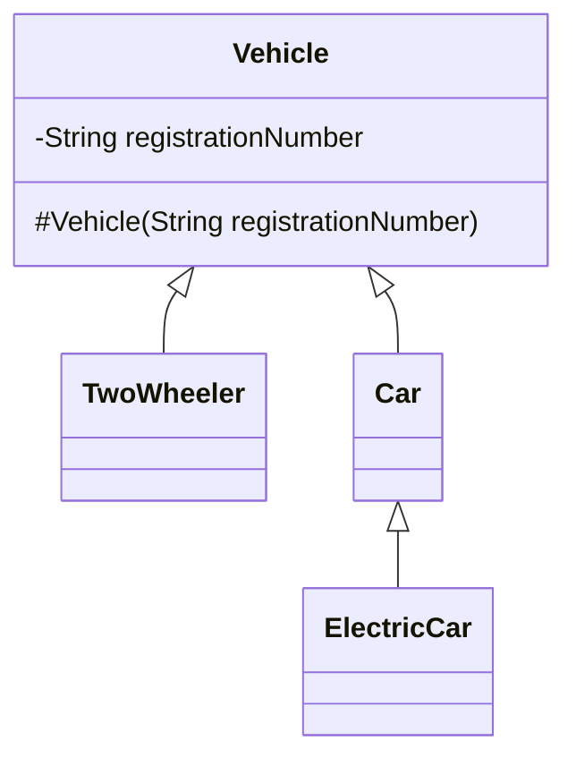

# Task 06: Build Vehicle Inheritance and Constructor Trace

`TwoWheeler` and `Car` both extend `Vehicle`, which is hierarchical inheritance. `ElectricCar` extends `Car`, which adds a multilevel chain. Each constructor calls `super(...)` before its own body; this forwards the registration number and guarantees parent initialization first.

The printed trace for `new ElectricCar("TN03C3")` is:

1. `Vehicle` constructor stores the registration number.
2. `Car` constructor runs after `Vehicle` returns.
3. `ElectricCar` constructor runs after `Car` returns.

The demo turns trace printing off after the one visible trace so it can warm up and measure repeated object construction without flooding the console.

## Alternative Concept and Complexity Analysis

Composition could make `Vehicle` hold a `VehicleType` object that stores rate and capabilities. Adding a type then usually adds a type/configuration object rather than another subclass; it avoids a deep hierarchy when many independent capabilities combine. Inheritance keeps shared state and subtype behavior directly visible for this assignment. Constructing one object is $O(1)$ time and space; storing `n` vehicles is $O(n)$ space. The measured `System.nanoTime()` sample warms up 2,000 objects and averages 20,000 allocations; allocation/GC and JIT effects mean the result is not a stable cross-machine comparison.