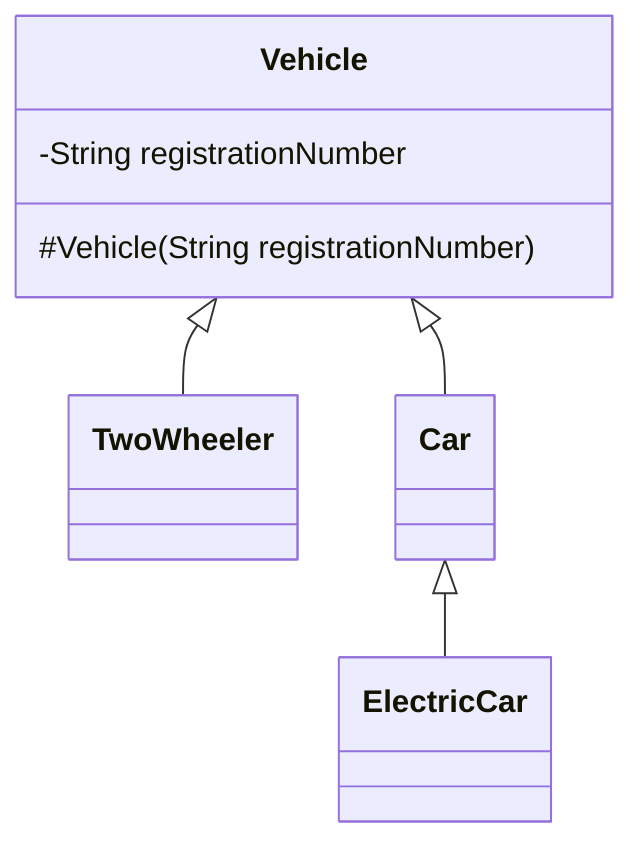

# Final Report: Campus Smart-Parking System

## Scope and Environment

This submission implements and documents the progressive CSA09 Tasks 1-12. The local run used Temurin OpenJDK 25.0.4.1; the source stays compatible with JDK 17+ (including pattern matching for `instanceof` in Task08). Each task compiles independently into a temporary directory. Runtime transcripts are captured in UTF-8 in the task's `output.txt`; timing evidence is also separated where exact expected output must remain untouched.

The starter `ParkingFacility.java` and `FeeDemo.java` files mentioned in the task brief were absent from the provided workspace. Their implementations were therefore created from the detailed API/output requirements. The Task03 and Task08 main behavior was reproduced as specified, and the required outputs were checked exactly; the report cannot claim that unseen original source text was left unchanged.

## Task Evidence

### Task 01: Problem Analysis and Candidate Objects

Inputs include registration/type, driver category/pass, entry/exit action and time, EV energy, and floor configuration. Outputs include a ticket and location at entry, a fee and released slot at exit, or a clear rejection. Candidate objects and responsibilities are listed in [Task01/notes.md](../Task01/notes.md): facility, floor/slot, vehicle subtypes, ticket, driver/pass, and pricing rule. Nouns identify state-bearing candidates; verbs identify operations such as `enter`, `allocateSlot`, `issueTicket`, `exit`, `calculateFee`, and validation. Assumptions include zero-based internal indexes, pass eligibility, integer started-hour billing, and separate EV energy billing. The executable search comparison and real timing are in [Task01/output.txt](../Task01/output.txt).

### Task 02: Types, Jagged Arrays, and Casting

Slot/floor indexes use `int`; registration numbers use `String`; entry instants and duration use `long`; whole-rupee fees use `long`. The jagged `String[][]` represents floor capacities 2, 3, and 1. Command-line arguments supply an optional registration number. `CastDemo` demonstrates integer `130 / 60 == 2`, a cast after division still yielding `2.0`, and the correct integer ceiling `(130 + 59) / 60 == 3`. Actual output is in [Task02/output.txt](../Task02/output.txt).

### Task 03: Allocation and Release

Structured pseudocode in [Task03/notes.md](../Task03/notes.md) uses `BEGIN/END`, `INPUT/OUTPUT`, `IF/ELSE/ENDIF`, and `FOR/ENDFOR`. It explains `continue` for occupied slots, immediate `return` after allocation, `null` when full, validation on release, and integer-only fee slabs with a daily cap. The exact actual program output is:

```text
[0, 0]
[0, 1]
[1, 0]
null
true false false
[0, 1]
```

This matches the specified expected output. Real console capture: [Task03/output.txt](../Task03/output.txt). The separate warmed allocate/release timing is in [Task03/timing.txt](../Task03/timing.txt).

### Task 04: Constructors

`ParkingTicket` demonstrates a default constructor, overloads, full parameterized construction, `this(...)` chaining, and a copy constructor. The copy intentionally preserves the ticket number for demonstration; it is not a second production ticket. Notes explain `this`, stack-frame references, heap objects, pass-by-value references, and GC eligibility. Actual constructor output and timing: [Task04/output.txt](../Task04/output.txt).

### Task 05: Static State and Object Lifecycle

A static ticket sequence and occupancy count are shared by north/south gates; a static block initializes the class, and static methods expose class-level values. Entry returns a ticket object, exit accepts it, and cleared references illustrate GC eligibility without claiming deterministic collection. The demo and timing: [Task05/output.txt](../Task05/output.txt).

### Task 06: Inheritance and Constructor Trace

`Vehicle` has hierarchical subclasses `TwoWheeler` and `Car`; `ElectricCar extends Car` demonstrates multilevel inheritance. The constructor trace is Vehicle, Car, ElectricCar because each child invokes `super(...)` before its body. The UML is also included in [Task06/notes.md](../Task06/notes.md). Actual trace and timing: [Task06/output.txt](../Task06/output.txt).



### Task 07: Overrides and Equality

Subtypes override hourly rate and fee behavior with `@Override`; `Car` applies a daily cap. Override visibility cannot be reduced and return types must be compatible. Registration number defines equality and hash code across vehicle subtypes; `toString` is readable. A final field protects registration identity, a final method protects identity access, and a final leaf class prevents unsupported extension. Actual result and timing: [Task07/output.txt](../Task07/output.txt).

### Task 08: Polymorphic Fees

The compiler chooses between `calculateFee(int)` and `calculateFee(LocalTime, LocalTime)` based on argument types. A `Vehicle` variable referring to `Car` invokes the base `calculateFee`, whose `ratePerHour` call dispatches to `Car`. The fee demo calculates three started hours for 130 minutes; an EV additionally pays 10 kWh at Rs 12/kWh. Equality prints true because `equals` uses `instanceof Vehicle` and registration number, not `getClass()`. This is reasonable when registration number identifies the physical vehicle, provided duplicate active registrations are separately rejected; subtype-sensitive equality would be a different domain rule.

The exact real output, matching the required four lines:

```text
TwoWheeler TN01A1 -> Rs 30.0
Car TN02B2 -> Rs 90.0
ElectricCar TN03C3 -> Rs 210.0
true
```

See [Task08/output.txt](../Task08/output.txt) and the separate overload/dispatch trace in [Task08/polymorphism-output.txt](../Task08/polymorphism-output.txt).

### Task 09: Abstract Class and Interfaces

`Vehicle` is abstract because common registration state can be shared but an hourly rate is subtype-specific. `Chargeable` and `Payable` represent independent capabilities; an EV combines both through inheritance and interfaces. The demo shows default and static interface methods plus the actual parking and energy amounts. See [Task09/output.txt](../Task09/output.txt).

### Task 10: Packages, Access, and Validation

The package split is `parking.model`, `parking.service`, and `parking.app`. Private state protects invariants, public methods form cross-package APIs, protected duration validation serves subclasses, and package-private helpers remain package-local. Setters reject negative duration and invalid slots. The wrapper example shows cached `Integer` 127 identity, non-guaranteed 128 identity, and value equality with `.equals()`. Actual output and repeated validation timing: [Task10/output.txt](../Task10/output.txt).

### Task 11: Integrated System and Tests

The integrated model allocates a first-free jagged slot, stores active tickets in a registration-keyed `HashMap`, issues atomic unique numbers, rejects duplicate active registration numbers, unknown types, invalid slots, negative durations, and full capacity. Visitor time charges use these declared demonstration rates: two-wheeler Rs 10 first hour/Rs 8 additional/Rs 100 daily cap; car and EV Rs 30/Rs 20/Rs 200 cap. EV energy is Rs 12/kWh. A valid staff/student monthly pass waives parking time charges. The cap applies per started 24-hour duration segment, not calendar midnight; persistent ticket numbering across process restarts is outside this in-memory model.

Actual test table captured from the run:

| ID | Input | Expected | Actual | Result |
|---|---|---:|---:|---|
| T01 | Visitor TwoWheeler, 130 min | 26 | 26 | PASS |
| T02 | Visitor Car, 130 min | 70 | 70 | PASS |
| T03 | Visitor ElectricCar, 130 min + 10 kWh | 190 | 190 | PASS |
| T04 | One-slot facility, first entry | [0, 0] | [0, 0] | PASS |
| T05 | Car, 0 min | 0 | 0 | PASS |
| T06 | Car, exactly 60 min | 30 | 30 | PASS |
| T07 | Car, exactly 120 min | 50 | 50 | PASS |
| T08 | Car, exactly 1440 min | 200 | 200 | PASS |
| T09 | Unknown vehicle type | UNKNOWN_VEHICLE_TYPE | UNKNOWN_VEHICLE_TYPE | PASS |
| T10 | Duplicate active registration | DUPLICATE_REGISTRATION | DUPLICATE_REGISTRATION | PASS |
| T11 | Invalid slot index | INVALID_SLOT | INVALID_SLOT | PASS |
| T12 | Negative duration | NEGATIVE_DURATION | NEGATIVE_DURATION | PASS |
| T13 | Valid student pass | 0 | 0 | PASS |
| T14 | Valid staff pass | 0 | 0 | PASS |
| T15 | Full facility | NO_SLOT_FREE | NO_SLOT_FREE | PASS |

Day scenario hand calculation: visitor TwoWheeler for 61 minutes costs Rs 18; pass-holder Car costs Rs 0; visitor EV for one minute and 2 kWh costs Rs 30 + Rs 24 = Rs 54. Total Rs 72; the program printed Rs 72. Full actual table and total: [Task11/output.txt](../Task11/output.txt). Repeated array/list/map lookup measurements at 1,000, 10,000, and 100,000 records: [Task11/lookup-timings.txt](../Task11/lookup-timings.txt).

Evaluation: encapsulation protects slots and ticket state; inheritance specializes rates; polymorphism selects rates; abstraction hides fee and pass contracts. A limitation is the in-memory-only state and duration-day cap model.

### Task 12: Pricing and Pass Extension

Impact: e-bike flat pricing, delivery-van time-sensitive pricing, one-day visitor pass, and a five-floor layout with capacities `{2, 3, 1, 4, 2}`. A rectangular array would misrepresent unequal floor sizes. The extension adds `PricingRule` strategies and a `Pass` interface; Task11 committed classes remain unchanged. No existing Task11 class was modified. Delivery-van started hours are classified by their start time; hours starting in `[09:00, 17:00)` cost double the car rate, and the stated assumption is recorded in [Task12/notes.md](../Task12/notes.md).

Actual results include e-bike flat fee Rs 15; delivery van Rs 100 for two billed hours starting at 10:00; Rs 70 for two billed hours starting at 08:00 (one base-rate hour and one doubled hour); one-day pass Rs 0; visitor without pass Rs 50; negative duration rejected even with a pass; five unequal floor capacities printed. See [Task12/output.txt](../Task12/output.txt).

## Complexity and Alternative Summary

| Task | Alternative and comparison |
|---|---|
| 01 | Parallel arrays and object arrays both search in $O(n)$ and store $O(n)$; objects make adding an attribute safer and less index-coupled. |
| 02 | Jagged scan is $O(S)$ for `S` slots; a flat array with floor-prefix offsets provides validated direct lookup in $O(1)$, both $O(S+F)$ space. |
| 03 | First-free scan is $O(S)$ and release $O(1)$; free-slot stacks allow average $O(1)$ operations with $O(S+F)$ bookkeeping. |
| 04 | Constructor validation creates a valid object; setters/factories also take $O(1)$ per object but setters can expose invalid intermediate state. `n` objects take $O(n)$ time/space. |
| 05 | Static counter costs $O(1)$ shared state; per-facility counters cost $O(k)$ for `k` facilities and need namespaced IDs to avoid collisions. |
| 06 | Composition can isolate type/rate configuration; inheritance keeps shared state in a base. Construction is $O(1)$, storage $O(n)$ for `n` vehicles. |
| 07 | A central switch or up-to-`k` type-check chain costs up to $O(k)$; virtual dispatch is conceptually $O(1)$. |
| 08 | Casting chains may require $O(k)$ checks; polymorphic dispatch is conceptually $O(1)$ with $O(1)$ call space. |
| 09 | Interface-only state cannot provide per-instance constructor state; selected abstract class plus interfaces keeps calls and extra per-call space $O(1)$. |
| 10 | Central encapsulated validation costs $O(1)$ for slot/duration updates; public fields repeat checks at up to `m` call sites. |
| 11 | Array/ArrayList exit search is $O(n)$; HashMap average lookup is $O(1)$; each stores $O(n)$ tickets, with hash overhead. Measured values are in `lookup-timings.txt`. |
| 12 | A conditional pricing chain can cost $O(k)$ checks; PricingRule dispatch is $O(1)$, while delivery pricing scans `h` billed hours in $O(h)$. Jagged slot storage is $O(S)$. |

Task-specific warmed timing samples use `System.nanoTime()` where compatible with required output. These small measurements are JVM- and machine-dependent, include JIT effects, and are not formal benchmarks; see each task's `notes.md` and captured output/timing files.

## Output and Screenshot Evidence

Captured console evidence: [Task01/output.txt](../Task01/output.txt), [Task02/output.txt](../Task02/output.txt), [Task03/output.txt](../Task03/output.txt), [Task04/output.txt](../Task04/output.txt), [Task05/output.txt](../Task05/output.txt), [Task06/output.txt](../Task06/output.txt), [Task07/output.txt](../Task07/output.txt), [Task08/output.txt](../Task08/output.txt), [Task09/output.txt](../Task09/output.txt), [Task10/output.txt](../Task10/output.txt), [Task11/output.txt](../Task11/output.txt), and [Task12/output.txt](../Task12/output.txt).

Each task folder includes `screenshot-placeholder.txt`. No screenshot images have been fabricated; the student should take and add their own screenshots.
